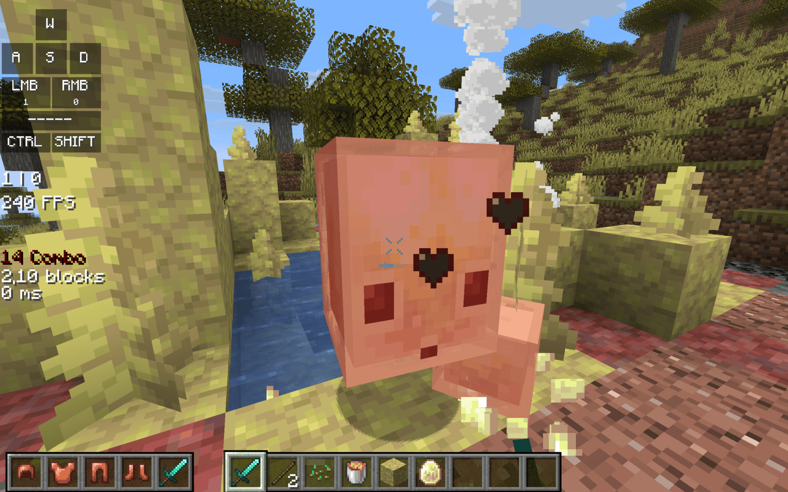
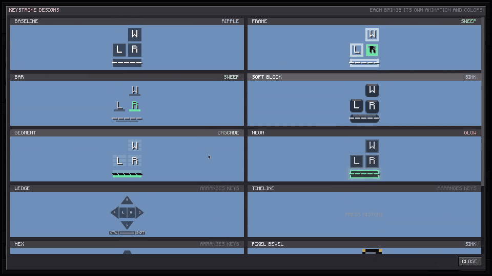
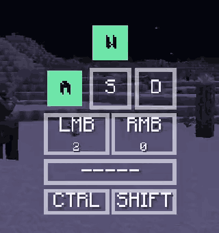
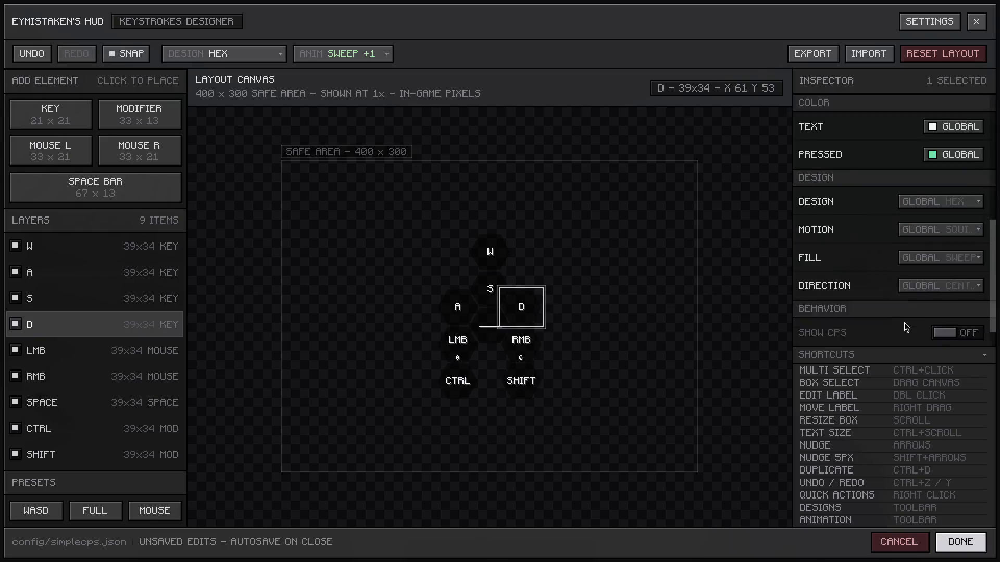
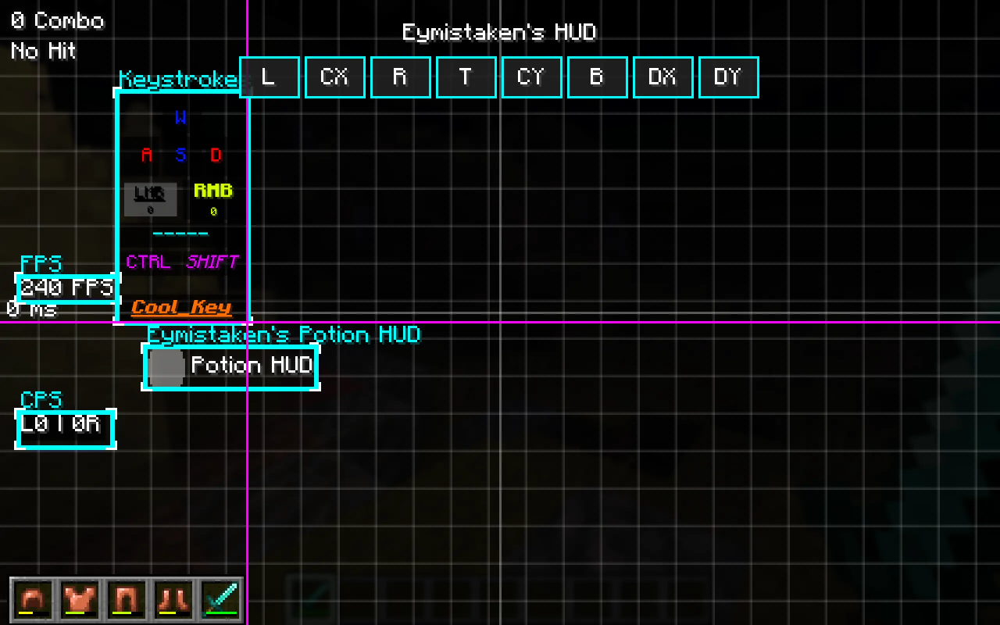
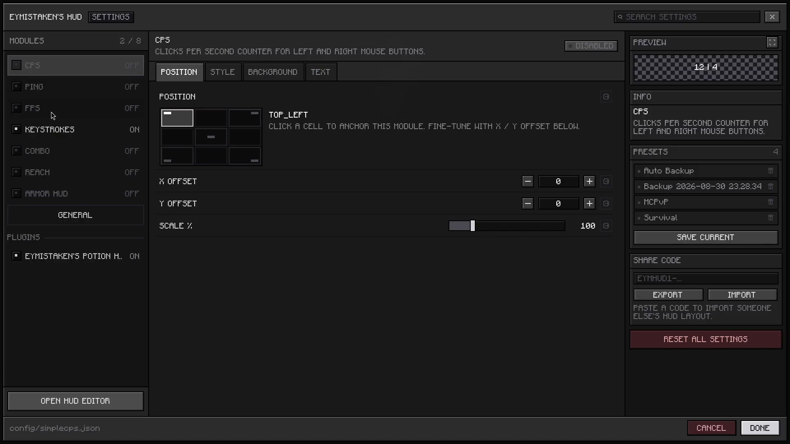
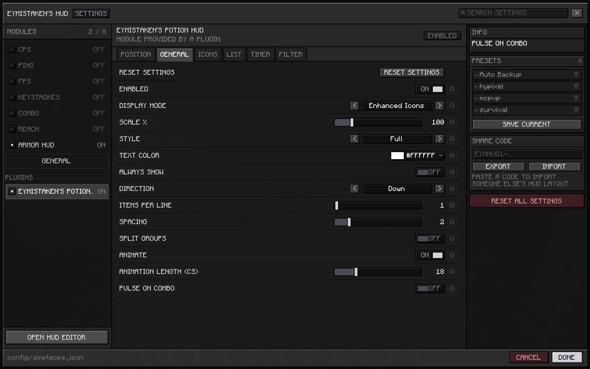

# Eymistaken's HUD

A client-side PvP HUD for Fabric. Seven modules, a live drag-and-drop editor, a keystrokes designer, layouts you can share as a line of text, and a plugin API for adding modules of your own.

[](https://modrinth.com/mod/eymistakenshud)
[](https://www.curseforge.com/minecraft/mc-mods/eymistakenshud)
[](https://github.com/Eymistaken/Eymistaken-s-HUD/releases/latest)


[](LICENCE)

**[Website](https://eymistaken.github.io/Eymistaken-s-HUD-Website/)** ·
**[User Guide](https://eymistaken.github.io/Eymistaken-s-HUD-Website/user-guide.html)** ·
**[API Guide](https://eymistaken.github.io/Eymistaken-s-HUD-Website/api-guide.html)** ·
**[Modrinth](https://modrinth.com/mod/eymistakenshud)** ·
**[CurseForge](https://www.curseforge.com/minecraft/mc-mods/eymistakenshud)**



## Modules

| Module | What it shows |
|---|---|
| **CPS** | Left and right clicks per second, with a configurable separator and free-text prefix and suffix, so it can read `12 \| 4`, `CPS: 12`, or anything else. |
| **Keystrokes** | Any keys and mouse buttons you choose, in a layout you draw yourself. Eleven designs, stackable press animations, per-key colors, and an optional CPS counter on any key. |
| **Combo** | Your current hit streak. It waits for the server to confirm each hit, colors the count through three heatmap tiers, shows a combo landed on you as a negative count, and records your best. |
| **Reach** | The distance of your last hit, to two decimal places. Can filter to players only and keep a placeholder label on screen before the first hit. |
| **Armor** | Armor, main hand and off hand as item icons with durability bars. Items react when they take a hit and warn you before they break. Every slot can be placed on its own. |
| **FPS** | Frames per second, with custom suffix, color, scale, rainbow mode and background. |
| **Ping** | Your latency to the server, read from your own player-list entry. |

Modules carry their own color, scale, background and opacity settings. Text can be drawn in vanilla or one of five bundled fonts (Inter, Rubik, JetBrains Mono, Bebas Neue and the enchanting-table font) with an optional outline in place of the vanilla shadow. Fonts apply to the HUD and the mod's own screens only, never to chat or vanilla menus.

## Keystrokes designer

The keystrokes layout is drawn in its own editor rather than picked from a list. Add keys, modifiers, mouse buttons and a space bar; resize them; move each label independently; and undo or redo any of it.

<p align="center">
  
  
</p>

How a key looks at rest and what it does when pressed are separate choices, and any combination works:

- **Designs** set the resting shape: Baseline, Frame, Bar, Soft Block, Segment, Neon, Wedge, Timeline, Hex, Pixel Bevel and Slot. Wedge and Hex also rearrange the keys into a compass and a honeycomb; Timeline lays them out as lanes of press history. Each design arrives with its own palette and animation, and all of it stays editable.
- **Motions** move the key: squish, kick, sink and nudge.
- **Fills** paint the key: ripple, sweep, cascade, hold ring, edge run and glow, each running from a chosen direction.
- **Ghost trail** sends an outline outward from a released key as it fades.

Motions and fills are sets, so several run at once. Any single key can override the design, motion, fill or direction set for the rest.



## In-game editor

Press **Right Shift** in game (rebindable under Controls). Everything in the editor is the live HUD.

- Drag any module, or any single armor slot, to place it exactly. Scroll over it to scale from 50% to 300%, or nudge it with the arrow keys.
- Right-click a module for a menu of its own settings without leaving the screen.
- Select two or more elements to align them left, center, right, top, middle or bottom, or distribute them evenly.
- Elements snap to each other's edges, with an optional 4, 8, 16 or 32 pixel grid.
- **Prevent Overlap** keeps two modules from covering the same pixels by moving one to the nearest free space.
- Right-click empty space for settings, presets, server configs, share codes and a full reset.



## Settings screen

One page per module, split into tabs, with a search box that finds any setting by name, a description and default for every row, a one-click reset on anything you have changed, and a live preview of the module you are editing. The screen keeps the same physical size at every GUI Scale, and that size can be adjusted from 50% to 200%.

Open it from Mod Menu, or from the editor's right-click menu.



## Layouts that travel

- **Presets** save the whole HUD under a name, stored as plain JSON in `config/simplecps_presets/`.
- **Per-server configs** remember a layout for each server you configure. Joining that server loads it silently, and changes made there are saved back to it.
- **Share codes** export the whole HUD, or just the keystrokes look, as one `EYMHUD1-…` string. Imports are validated before anything is applied, and a timestamped backup is taken first.

## Installation

| Requirement | Version |
|---|---|
| Minecraft | 26.3 |
| Java | 25 |
| Fabric Loader | 0.19.5 or newer |
| Fabric API | 0.160.6+26.3 or newer |
| Mod Menu | Optional; adds a button for the settings screen |

1. Install [Fabric Loader](https://fabricmc.net/use/) for Minecraft 26.3.
2. Put [Fabric API](https://modrinth.com/mod/fabric-api) and the Eymistaken's HUD jar in `.minecraft/mods/`.
3. Launch the game and press Right Shift.

Download the jar from [Modrinth](https://modrinth.com/mod/eymistakenshud), [CurseForge](https://www.curseforge.com/minecraft/mc-mods/eymistakenshud) or [GitHub Releases](https://github.com/Eymistaken/Eymistaken-s-HUD/releases/latest). The mod is client-side only and needs nothing on the server.

**Still on Minecraft 26.1 or 26.2?** v1.2.2 is the last build for those versions and stays available on all three.

## Building from source

You need JDK 25.

```bash
git clone https://github.com/Eymistaken/Eymistaken-s-HUD.git
cd Eymistaken-s-HUD
./gradlew build
```

The jars land in `build/libs/`. To launch a development client with the mod loaded:

```bash
./gradlew runClient
```

Mod Menu is a compile-only dependency and is not present in the development client, so reach the settings screen through the in-game editor there: Right Shift, then right-click empty space.

## Writing a plugin

Other mods can add modules to the HUD through the `eymistaken_hud` entrypoint. A registered module is ticked and drawn with the built-in ones, can be dragged and scaled in the editor, and gets a page in the settings screen with no extra work. If it opts in, its state also travels inside presets, share codes and per-server configs.

### Add the dependency

Builds are published through [JitPack](https://jitpack.io/#Eymistaken/Eymistaken-s-HUD):

```gradle
repositories {
    maven { url 'https://jitpack.io' }
}

dependencies {
    implementation 'com.github.Eymistaken:Eymistaken-s-HUD:1.2.4'
}
```

Minecraft 26.x runs unobfuscated and Loom no longer remaps mod dependencies, so this is a plain `implementation` rather than `modImplementation`. Use a release version without the leading `v`, or `main-SNAPSHOT` to track the main branch.

The mod id is `simplecps`; declare it under `depends` or `suggests` in your `fabric.mod.json` as appropriate.

### Register the entrypoint

```json
"entrypoints": {
    "eymistaken_hud": [
        "com.example.myaddon.MyPlugin"
    ]
}
```

```java
import com.eymistaken.simplecps.HudModuleManager;
import com.eymistaken.simplecps.api.EymistakenHudEventBus;
import com.eymistaken.simplecps.api.EymistakenHudPlugin;
import com.eymistaken.simplecps.api.event.ComboStreakEvent;

public class MyPlugin implements EymistakenHudPlugin {
    @Override
    public void registerHudModules(HudModuleManager manager) {
        manager.registerModule(new MyModule());
    }

    @Override
    public void registerEvents(EymistakenHudEventBus bus) {
        bus.subscribe(ComboStreakEvent.class, event -> {
            // Fired once per heatmap tier, not once per hit.
            if (event.level() >= 2) onHotStreak(event.target());
        });
    }
}
```

### Write a module

A module extends `HudModule`, reports its size in screen pixels with its scale applied, and draws itself from its own origin:

```java
import com.eymistaken.simplecps.SimpleCPSConfig;
import com.eymistaken.simplecps.api.HudModule;
import net.minecraft.client.gui.GuiGraphicsExtractor;

public class MyModule extends HudModule {
    private static final String TEXT = "Hello";

    @Override public String getName() { return "myaddon:greeting"; }  // unique; prefix it with your mod id

    @Override public SimpleCPSConfig.Position getPositionType() { return SimpleCPSConfig.Position.TOP_LEFT; }
    @Override public int getXOffset() { return 0; }
    @Override public int getYOffset() { return 0; }
    @Override public boolean isEnabled() { return true; }

    private float scale() { return getScale() / 100f; }

    @Override public int getWidth()  { return Math.round(textWidth(TEXT) * scale()); }
    @Override public int getHeight() { return Math.round(client.font.lineHeight * scale()); }

    @Override
    public void extractRenderState(GuiGraphicsExtractor context, float tickDelta) {
        context.pose().pushMatrix();
        context.pose().translate((float) x, (float) y);
        context.pose().scale(scale(), scale());
        drawText(context, TEXT, 0, 0, 0xFFFFFFFF);  // honors the player's font and outline
        context.pose().popMatrix();
    }
}
```

From there, a module can override the position and scale setters so the editor can move it, return settings from `getContextMenuSettings()` for its right-click menu, split its settings page into tabs with `getSettingsTabs()`, provide a live preview through `getPreview()`, expose independently placeable parts with `getSubElements()`, and persist its own state through `saveState()` and `loadState()`. The six setting types (`BooleanSetting`, `ColorSetting`, `SliderSetting`, `CycleSetting`, `TextSetting` and `ActionSetting`) live in `com.eymistaken.simplecps.api`.

Every one of those hooks has a default, so a module compiled against an older build keeps working. The [API Guide](https://eymistaken.github.io/Eymistaken-s-HUD-Website/api-guide.html) covers each of them with full examples.



## How it fits together

```
src/main/java/com/eymistaken/simplecps/
├── api/                    Public plugin API: HudModule, setting types, events, HudPreview
├── gui/                    In-game editor, keystrokes designer, color picker
│   └── settings/           Settings screen and the shared screen toolkit
├── mixin/                  Client-only hooks: input, client tick, attacks, combat packets
├── modules/                The seven built-in modules and the keystrokes renderer
├── util/                   Share codes, fonts, input-code migration, easing
├── SimpleCPSClient         Client initializer
├── HudModuleManager        Module registry; ticks and renders every module
├── HudPlacementResolver    Layout engine
└── SimpleCPSConfig         The single persisted config
```

- **`SimpleCPSClient`** reads the config, builds the module registry, discovers plugins through the `eymistaken_hud` entrypoint, registers the editor key, and attaches the HUD layer beneath chat.
- **`HudPlacementResolver`** is a pure function from modules and screen size to rectangles. It anchors each module to a corner or the center, stacks modules that share an edge, and, with Prevent Overlap on, moves colliding elements to the nearest free space. A module with an explicit offset is placed exactly and never stacked.
- **`SimpleCPSConfig`** is one flat object serialized with Gson to `config/simplecps.json` through an atomic write. Its public field names are the keys on disk, so renaming one silently drops that setting from every existing config.
- **Share codes** are `EYMHUD1-` followed by base64url-encoded, gzipped JSON in a versioned envelope. A code carries either the whole config or the whole keystrokes look, and applying the wrong kind is rejected rather than half-applied. Decoding is size-bounded, because the input comes from someone else.
- **Mixins** are client-only and limited to reading input, ticking modules, recording attacks, and listening to the packets that confirm hits and swings. Nothing in gameplay logic is changed.

The internal id is `simplecps` throughout (mod id, package, config file) while the published name is Eymistaken's HUD. The two differ on purpose; the id is kept because existing configs and plugins depend on it.

## Contributing

Bug reports and feature requests go to [Issues](https://github.com/Eymistaken/Eymistaken-s-HUD/issues). For a bug, include the mod version, the Minecraft and Fabric Loader versions, and the log if the game crashed.

There is no automated test suite; changes are verified by running the development client and exercising the HUD in game. Code, comments and commit messages use American English.

## License

Released under the [MIT License](LICENCE).
